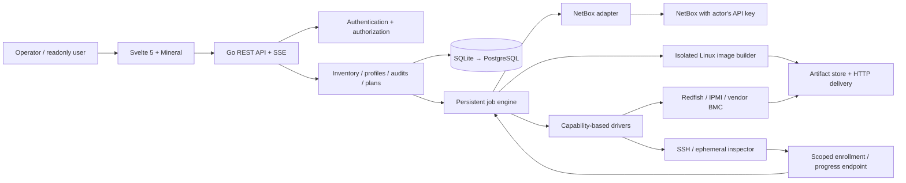
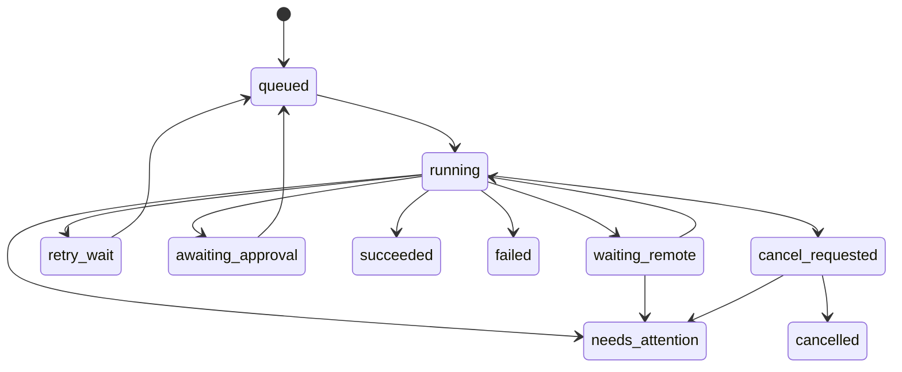

# Forge architecture

Design date: 2026-11-03. This is an implementation specification, not a claim that these capabilities already exist.

**Updated workspace decision:** Forge has one shared workspace and one list of users, connections and profiles. Do not add user-facing environments, environment selectors or membership administration. References below to environment partitions are superseded by this decision. Existing database scope IDs remain internal only to preserve encrypted credentials and existing records. Roles remain full/readonly, each user retains their own NetBox key, and cached NetBox evidence remains actor-scoped.

## 1. Architectural decision

Build a **modular Go monolith with a persistent job engine**, a Svelte 5 SPA, SQLite, and a filesystem artifact store. Run one application process in the MVP. Isolate Linux image-building tools in a builder process/container. Keep adapters and repository interfaces explicit so PostgreSQL, remote site workers and additional drivers can be added without redesigning the domain.

The main workflow is:

**Select → snapshot → inspect → audit → propose → approve → apply → verify → provision → verify readiness.**

Every audit is read-only with respect to managed infrastructure. Every mutation is an explicit typed action in an immutable approved plan. Reading hardware may create a temporary authentication session, but an inspection must never reboot, mount media, change RAID, or alter the machine.



Do not add Kubernetes, Redis, Kafka, Temporal, a general plugin marketplace, or a permanently installed host agent to the MVP. The hard problems are identity, correct reconciliation, hardware qualification and recovery after uncertain external effects.

## 2. Product scope and release boundaries

| Release | Deliverables | Deliberately deferred |
|---|---|---|
| Foundation | Named local users, bootstrap, two roles, per-user NetBox credentials, filtered inventory, profiles, jobs, mock adapters | Live infrastructure writes |
| Audit release | Cached Redfish inventory and BIOS, captured BIOS baselines, field/hardware/network/cable checks, immutable plans, approved NetBox changes, XLSX | OS installation |
| Provisioning MVP | Direct cable proposals, Ubuntu and Rocky customized ISO installation, software RAID/LVM, files/users/SSH keys/scripts, readiness verification | Generic QCOW2 writing, hardware RAID mutation, PXE, Windows |
| Operational release | FreeIPA, actual vendor/firmware qualification, backup/recovery, PostgreSQL implementation | HA until its concurrency model is tested |
| Extensions | QCOW2 deploy ISO, qualified hardware RAID/BIOS mutation adapters, switch LLDP collection, IPMI fallback, remote site workers, optional PXE/iPXE | No implicit promise of every vendor feature |

FreeIPA and PostgreSQL are required planned capabilities, not assumptions that SQLite/local auth somehow provide them. A bounded early MVP may ship before them; their acceptance criteria remain on the roadmap. Ubuntu and Rocky both belong in the provisioning MVP. Supporting Ubuntu does not imply supporting Debian Installer; supporting Rocky does not imply every RPM distribution.

Confirmed vendor targets: Gigabyte, Lenovo, Yadro. Exact models, controller generations, firmware, licensing and available Redfish privileges must be recorded in a qualification matrix. “Redfish present” does not imply complete NIC inventory, hardware RAID configuration, or working remote media.

## 3. Authority, identity and data ownership

Maintain three separate representations:

| Representation | Authority | Examples |
|---|---|---|
| Declared inventory | NetBox | Device identity, rack, interfaces, cables, IP assignments, VRFs, VLANs |
| Desired configuration | Versioned Forge profiles and allocation imports | Expected ports, interface graph, network assignments, disks, OS configuration |
| Observed state | Timestamped driver observations | Serial number, NIC MAC/PCI location, drives, RAID, link neighbors, installed OS |

Forge owns workflow state, findings, approvals, artifact metadata, observations and execution history. Do not copy these into NetBox comments, custom fields or journals. An optional compact deployment status/tag update must itself be an approved action; it is off by default.

Give each managed server a Forge UUID and a unique `(netbox_instance_id, netbox_device_id)`. Hostnames and serial numbers are attributes and reconciliation evidence, not primary keys. Renames preserve identity. Serial mismatch blocks destructive actions; it never silently changes the device association. A deleted NetBox object becomes a tombstone after a confirmed deletion; a filtered result or permission failure is not evidence of deletion. A replacement device ID requires an explicit relink procedure with fresh identity evidence.

Record a fingerprint from available system UUID, chassis serial and stable NIC/disk identities. Manufacturer serials may be missing, duplicated or formatted differently. Support explicit normalized comparisons while preserving the original values. Missing evidence yields `unknown`, not a match.

Version every plan input: selected device IDs, NetBox snapshot, observations, profile revisions, allocation file hash, adapter versions, image checksums and rendered configuration. Once approved, that input set cannot change in place.

## 4. Backend boundaries and repository structure

Suggested layout (create modules as they are needed):

```text
cmd/forge/                  API, embedded SPA, worker loop, CLI subcommands
cmd/forge-builder/          Linux-only artifact builder entry point
internal/auth/              bootstrap, local tokens, FreeIPA, sessions, roles
internal/inventory/         local server registry and inventory snapshots
internal/profiles/          parsing, schema validation, matching, revisions
internal/observations/      hardware snapshots, freshness, normalization
internal/compliance/        pure rules and findings
internal/plans/             action graph, approvals, preconditions, execution
internal/cabling/           candidate generation, ranking, reservations
internal/provisioning/      deployment specs, installers, readiness
internal/jobs/              durable queue, steps, leases, retry/recovery
internal/artifacts/         storage, manifests, grants, retention
internal/exports/           XLSX generation
internal/adapters/netbox/   versioned DTOs, HTTP transport, capability checks
internal/adapters/redfish/  discovery, normalization, generic operations
internal/adapters/vendors/ small qualified Gigabyte/Lenovo/Yadro extensions
internal/adapters/ssh/      host inspection and readiness
internal/adapters/ipmi/     later fallback
internal/store/            repositories and transactions
internal/store/sqlite/     SQLite implementation and migrations
internal/store/postgres/   later implementation and migrations
internal/httpapi/          routing, DTOs, middleware, SSE
web/                       Svelte 5 + TypeScript + Vite
api/openapi.yaml           HTTP contract
schemas/                   internal typed profile/import contracts
testdata/                  sanitized NetBox and BMC fixtures
docs/                      architecture, qualification and operations
```

Use standard Go `net/http`, `context`, `database/sql`, `log/slog`, `net/netip`, and `embed`. Choose maintained, pinned libraries when implementation starts; avoid specifying unverified current versions here. Wrap any Redfish client such as [gofish](https://pkg.go.dev/github.com/stmcginnis/gofish) behind Forge interfaces. Use a Go XLSX writer such as Excelize after dependency review. A small explicit NetBox REST client is preferable to letting a generated client dictate the domain.

Domain rules take typed values and have no HTTP, database or Svelte dependencies. HTTP handlers authenticate, validate, call services and serialize results. Only adapters know vendor payloads. Persist jobs before returning `202 Accepted`; do not start untracked goroutines from handlers.

Use OpenAPI to generate frontend types/client code. Keep policy and capability checks on the backend; frontend button visibility is only a convenience.

## 5. Profiles and deterministic resolution

Profiles are **application objects created through structured forms and visual editors from the MVP**. They are not Kubernetes-style manifests, and a YAML/JSON text editor is not an acceptable substitute for the profile UI. Use typed JSON for internal API/storage contracts and immutable published revisions in the database. Users work with names, selectors, tables, topology/layout previews and field-level validation. The backend owns serialization and schema migrations.

Keep YAML only for the requested Kayobe-style allocation data import. Reject duplicate YAML keys, unsafe tags, recursive aliases and excessive size/depth there. Do not execute templates or scripts while validating. Optional profile backup/transfer can use a generated application bundle later, but it is not the normal authoring workflow.

| Profile kind | Responsibility |
|---|---|
| Connection | Environment/vendor/model/role selectors; driver; BMC address source; system selector; stored or derived credentials; CA/pins; timeouts |
| Hardware compliance | Required fields, serial match, supported model, CPU/RAM/NIC/disk requirements, optional expected controller/RAID layout |
| BIOS compliance | Immutable baseline captured from a reference host; chosen active attributes; vendor/model/firmware/registry applicability; explicit hardware-family variants |
| Network | Physical/bond/VLAN/bridge graph, link identity bindings, MTU, routes, DNS, addressing and IPAM references |
| Storage | Exact disk selection policy, hardware RAID expectations, software RAID, partitions, filesystems, LVM, boot layout |
| Cabling | Allowed switches/ports, rack proximity, speed/media constraints, redundancy domains, cable policy |
| Installation | Distribution/release/architecture, base artifact, installer backend, users/keys/files/packages/scripts and readiness |
| Onboarding bundle | Explicit references to the above revisions and approved overrides |

Resolution algorithm:

1. Match against the selected NetBox snapshot and environment. Any data needed to choose the connection profile must be available before hardware inspection.
2. An explicit per-server assignment wins; otherwise choose the matching profile with the highest explicit priority.
3. Equal highest-priority matches are an error. Display all matches and the reason; do not silently use list order.
4. Resolve referenced revisions and typed per-server overrides into one immutable `ResolvedSpec`.
5. Validate the whole graph and adapter support. Missing required capability blocks the affected operation.

Do not implement implicit deep merging across many profiles in v1. Explicit composition is easier to explain and test. Credentials are opaque references selected through permission-aware pickers; profile exports never contain passwords or NetBox tokens. Published revisions are immutable; editing starts a draft with a form-based change summary and affected-server preview before publishing. See [profile editor design](profile-design.md) for mandatory screens and interactions.

**Both static and derived BMC passwords are MVP requirements.** Static mode selects/creates an encrypted password. Derived mode's primary preset is `optional secret prefix + last octet of BMC IPv4 + optional secret suffix`, with explicit decimal padding. Support prefix-only, suffix-only and prefix-plus-suffix combinations. Example: resolved BMC address `10.20.30.47` produces `<prefix>47<suffix>`, or `<prefix>047<suffix>` with width 3. Derive from the exact canonical management IP used for the connection, never a host's primary/data IP. Configure the address source once and reuse its resolved value for connection and credential calculation.

An advanced form-based recipe can concatenate secret references and allowlisted field transforms: BMC IPv4 octet, declared NetBox serial substring, case conversion, trimming and padding. NetBox serial is available before the first BMC login; the observed Redfish serial is not. Store the recipe and secret references, not its output. Resolve the secret and derive the password just in time in memory; exclude it from snapshots, logs, jobs, exports and UI previews. Secrets entered into a prefix/suffix control go into encrypted secret storage.

Use typed extraction, not arbitrary Go templates, expressions, shell commands or trial-and-error credential candidates. Parse IPv4 with `net/netip` and extract the numerical final octet, handling `.0`/`.255` as values without assuming their subnet role. An IPv6-only address has no IPv4 last octet and fails this preset. If the endpoint is a hostname, require an explicitly bound management IPv4 (or a documented deterministic single-address resolution policy) and connect to that same pinned IP while preserving the configured TLS server name. Multiple possible addresses are an error, not a random choice. Address or source-serial changes invalidate the resolved target/credential inputs; refresh and replan affected pending actions. Authentication failure does not trigger guessing alternate octets or serial slices.

Credential derivation authenticates to an already configured BMC; it does not change/reset the BMC password. The example's main concern is IP-octet derivation; serial-based rules are an optional recipe extension. Hardware inspection still compares the observed serial with NetBox after login and blocks destructive work on mismatch.

The network model needs two separate concepts: `netbox_vrf` is the intended IPAM routing context; an optional `linux_vrf` is an actual OS interface/routing table. Do not automatically configure Linux VRFs because an address lives in a NetBox VRF.

## 6. NetBox integration and request control

On connection, inspect the API root/status/version information available to that account and its schema/OPTIONS metadata where permitted. Record a compatibility report. Bind supported behavior to tested API versions/features; unknown versions can be inspected conservatively but writes stay disabled until their contract is validated. No silent “probably 4.x/5.x” mode.

Relevant resources include devices/device types/roles, sites/locations/racks, interfaces and MAC objects, cables, VRFs, VLANs/groups, prefixes and IP addresses. Resolve platform, tenant and custom fields only when a rule uses them. Follow pagination and scope every query to the selected data or required related objects. Stable NetBox documentation describes bulk writes and conditional updates, but installed releases may differ; capability-test support instead of assuming it. [NetBox REST API](https://netbox.readthedocs.io/en/stable/integrations/rest-api/)

Preserve a DTO translation layer for changes such as primary MAC address relations and interface attributes. Keep logical interface parent/LAG relationships separate from physical cable endpoints. [NetBox interface model](https://netbox.readthedocs.io/en/stable/models/dcim/interface/)

### Read pipeline

Filter by site, location, rack, tenant, role, manufacturer, device type, status, tags, name and approved custom fields. A selection freezes explicit device IDs; later filter matches never enter an already approved batch. Fetch related data in bounded chunks to avoid N+1 requests, long URLs and unbounded response bodies. Do not fetch the whole NetBox installation for a ten-device audit.

Store observations/snapshots locally and render the UI from them. Show `fetched_at`, source, completeness and freshness. Suggested starting defaults: NetBox metadata 5 minutes, inventory hardware 6 hours, link observations 5 minutes; all configurable. Mutation preflight always re-reads affected objects regardless of display cache TTL.

### Rate limits

“Debounce” solves repeated UI searches; it does not solve a server rate limit. Implement all of these:

- Debounce search input by roughly 300 ms; cancel obsolete UI requests.
- Coalesce identical concurrent reads only within the same authorization/credential generation.
- A shared per-NetBox-host token bucket plus a per-user budget and concurrency limit; start conservatively at 2 requests/second, burst 4, two in-flight requests for the host. Tune from measurements.
- On 429, honor `Retry-After` (seconds or HTTP date), set a host-wide cooldown and schedule `next_attempt_at`. Use capped exponential backoff with full jitter when the header is absent. Never retry earlier than the server asks.
- Fair scheduling prevents one large audit starving other users. Retry waits occupy no worker or DB transaction.
- Bound retry count and elapsed time; show “waiting for NetBox” and the next eligible time. Adaptive recovery increases concurrency slowly after a healthy period.
- Retry safe reads on transient transport/502/503/504 failures. Authentication/permission failures need operator action. Handle ambiguous writes through reconciliation, not generic HTTP retries.

Per-host cooldown is conservative because a proxy may rate-limit the shared egress address. In a future multi-process deployment, limiter state must be coordinated across workers.

### Per-user authorization

Every interactive or background NetBox operation uses the initiating actor's stored credential, never an application-wide fallback. A scheduled task has an explicit owning user. Persist the credential ID/generation and actor on the job; resolve/decrypt it only for execution. Revocation, disabled actor or role loss prevents subsequent mutations and parks the job. A still-running remote installation cannot always be stopped by revoking a token.

Partition raw NetBox read caches by `(instance, user, credential generation, normalized request)`. Never serve another user's cached API response. A shared internal server registry is permitted, but every visible device, related object, finding, job, event and export is subject to the viewer's authorized NetBox scope and Forge environment scope. Use short-lived per-user visibility proofs and revalidate on sensitive reads/actions; if visibility cannot be established, fail closed. The MVP may accept this extra request cost rather than leak data. Already approved local tasks do not grant ongoing visibility after revocation.

Background results can be retained for audit while no longer visible to their former owner. Credentials and raw secret-bearing payloads are never returned to readonly users or other full users.

## 7. Hardware inspection and driver contracts

Use a registry of small capability interfaces, not a single huge “server driver.” Built-in Go adapters are enough initially. Later external adapters may use a versioned JSON-RPC/gRPC subprocess protocol with bounded messages, execution deadlines and a capability manifest. Do not use Go dynamic `.so` plugins as the portability contract.

Illustrative contracts:

```go
type Inspector interface {
    Discover(context.Context, Target) (Capabilities, error)
    Inspect(context.Context, Target, InspectionRequest) (Observation, error)
}
type PowerController interface {
    ReadPower(context.Context, Target) (PowerState, error)
    SetPower(context.Context, Target, PowerIntent, OperationID) (OperationRef, error)
}
type MediaController interface {
    ReadMedia(context.Context, Target) (MediaState, error)
    Mount(context.Context, Target, MediaSpec, OperationID) (OperationRef, error)
    Eject(context.Context, Target, OperationID) (OperationRef, error)
}
type BootController interface {
    SetNextBoot(context.Context, Target, BootSpec, OperationID) (OperationRef, error)
}
type RAIDController interface {
    Plan(context.Context, Target, StorageSpec) (HardwarePlan, error)
    Apply(context.Context, Target, HardwarePlan, OperationID) (OperationRef, error)
}
type OperationObserver interface {
    ObserveOperation(context.Context, Target, OperationRef) (OperationStatus, error)
}
```

These names are design examples; implementation must define all associated types. `OperationID` is Forge's correlation key, not a promise that a BMC honors idempotency. `Target` contains validated identity/endpoint and a scoped secret handle; never serialize a cleartext credential into a job.

Capabilities have states `supported`, `unsupported`, `unknown`, `denied`, with evidence and restrictions. Example restrictions: needs power-off, needs license, only certain media protocols, requires reset, RAID controller family. A missing response field is unknown, not an empty inventory.

Discover resources from the Redfish service root and links. Do not hardcode `/Systems/1` or a particular manager path. Require an explicit system selection if the BMC exposes multiple systems. Follow task monitors/TaskService and pending settings where implemented; persist remote operation references before polling. Schema support is not proof that a particular controller implements a feature. DMTF defines media attachment actions and several possible resource locations. [Redfish VirtualMedia schema](https://redfish.dmtf.org/schemas/v1/VirtualMedia.v1_7_0.json)

Normalize system/chassis IDs and serials, vendor/model, BIOS/BMC firmware, CPUs, DIMMs, physical NIC ports and permanent MACs, PCI location, disks/WWNs/serials/slots/capacity, controllers, volumes and health. Collect active BIOS attributes, pending settings and attribute-registry metadata as distinct observation domains where available. Record units explicitly. Preserve sanitized raw payloads for diagnosis alongside normalized data and schema version.

BMC data often cannot establish Linux interface names, every NIC, bonds, VLANs, software RAID/LVM or actual cabling. Supplement it with authenticated SSH inspection of an existing OS, or an ephemeral discovery ISO with an inventory agent. **Booting that ISO is a separate approved disruptive action**, even though its agent only reads disks. The inspection result states which domains were covered and which were unavailable.

Match NICs by permanent MAC plus PCI/physical-port evidence and explicit overrides; distinguish BMC/shared-NIC addresses, switch ports, physical NICs, PFs/VFs and logical interfaces. Never infer that the first Redfish port is Linux `eth0`. Missing/ambiguous identity bindings block generated network configuration until resolved.

Cache observations in the database by server, driver/version, connection-profile revision and collection request. Record collection start/end, source identity, errors, completeness and validity. Keep last-known-good data when a refresh fails, marking it stale. Coalesce refreshes and cap per-BMC concurrency at one initially; use a bounded global inspection pool.

Vendor qualification starts with generic Redfish and adds the smallest needed override. Lenovo documents virtual-media variations and a session-related media unmount issue; media lifetime must therefore be tested across session expiry/logout and long installations. Do not assume that closing a Redfish session after mount is harmless. [Lenovo media API](https://pubs.lenovo.com/xcc2-restapi/insert_eject_virtual_media_patch), [Lenovo session advisory](https://datacentersupport.lenovo.com/us/en/products/servers/thinksystem/sr250v2/solutions/tt3633-virtual-media-unexpectedly-unmounting-with-redfish-session-authentication-lenovo-thinksystem)

## 8. Compliance rules and remediation

Define a pure rule interface: `Evaluate(ResolvedSpec, NetBoxSnapshot, ObservationSet) -> []Finding`. Network calls happen before evaluation. Findings identify rule/version, object, expected/actual values, evidence IDs, severity, status and optional proposed actions.

Statuses: `pass`, `fail`, `unknown`, `not_applicable`, `error`. An inspection error is not noncompliance; unsupported evidence is not a pass. Severity and install-blocking policy are separate. Waivers require actor, reason, expiry and exact finding scope; changing identity or disks invalidates the waiver. Identity mismatch and ambiguous destructive targets are non-waivable for automated installation.

Rules include:

- NetBox field presence and validity: serial, role, device type/manufacturer, rack/site/location, platform, required tags/custom fields and management endpoint.
- Hardware identity/model comparison; CPU/RAM/disk/NIC count and attributes; controller/volume expectations when observable.
- BIOS compliance against a selected reference-host baseline variant, using active values and explicit compatibility checks; pending values are explanatory evidence, not an active pass.
- Physical NIC completeness versus inventory, logical interface graph, bonds/members, VLAN parents, MTU, interface type and address assignment.
- IP existence, CIDR length, correct VRF/prefix, exact intended interface, expected status, duplicate/ambiguous assignment and primary-IP consistency.
- Cable documentation, expected switch/rack/redundancy domain, and separately observed peer agreement.
- Installation prerequisites: known target disks, supported installer features, management/data-path reachability evidence and profile consistency.

Create missing NetBox interfaces and IPs only through proposed actions. An unexpected interface is a finding, not automatic deletion. A serial mismatch needs investigation; do not “repair” the serial to hide it. Do not automatically move a live IP from an unrelated device or tear down existing cables.

### BIOS reference-host baselines

Provide “Create BIOS profile from this host” on an inspected server. Capture active settings and registry metadata into a draft, retain the reference server/observation and firmware identity, exclude sensitive, host-specific and transient fields by default, and let the operator choose the remaining attributes through a searchable typed table. Publish an immutable baseline revision; subsequent changes to the reference host must not change the baseline automatically.

Each baseline variant declares manufacturer, model/system-SKU and compatible BIOS firmware/attribute-registry constraints, plus controller/CPU-generation predicates when relevant. Default to the captured family and exact registry identity/content hash; a wider firmware range requires explicit validation. Match the actual target observation, not just its NetBox device type. No compatible variant yields `not_applicable` plus an installation blocker if the bundle requires BIOS coverage; absent evidence yields `unknown`; multiple matching variants are an error. Neither is silently a pass.

One named BIOS profile can group separately captured or explicitly mapped variants for Gigabyte/Lenovo/Yadro model families. Compare typed native attribute IDs and enum values within a qualified variant. Do not compare display strings or assume identical field names across vendors imply identical meaning. An optional normalized policy such as “virtualization enabled” requires explicit tested mappings for each family. Missing attributes, changed registry semantics and read-only targets are surfaced, not ignored. Effective active values determine compliance; desired pending values show “pending reboot” until a fresh active-state observation confirms them.

Creating/capturing/auditing a BIOS profile never applies settings. Future mutation plans must validate writable attributes and registry dependencies, preserve unrelated pending settings, stage only approved changes, use an approved reset/apply time, and verify active values afterwards. BIOS reset-to-defaults and firmware flashing are separate operations, not generic compliance fixes. The [DMTF BIOS schema](https://redfish.dmtf.org/schemas/v1/Bios.v1_2_3.json) defines attribute/registry and settings mechanisms; the baseline/variant workflow is Forge's application design.

### Allocation import

Accept Kayobe-style maps such as `ctl_ips: {host1: 192.0.2.11}` and `tun_ips: {host1: 198.51.100.11}`. This is a data import, not execution of Kayobe/Ansible/Jinja. Unknown top-level groups are reported and ignored unless referenced by a selected profile.

For each selected device, derive a unique allocation key from its exact name or explicit alias. Do not silently strip domains or lowercase arbitrary names; configurable normalization must detect collisions. Ignore extra hosts when producing assignments and actions. Report their count; they do not enlarge the selection. Reject malformed YAML globally, but unrelated hosts' value validation should not block selected hosts. Missing required selected-host entries fail validation.

An IP string alone does not identify prefix, VRF, VLAN, gateway or interface. The network profile must supply those bindings. Use `net/netip`; support IPv4 and IPv6. Validate addresses against the configured prefix, mask, reserved ranges and gateway policy. Equal numerical addresses in distinct VRFs may be intentional; duplicates within a target VRF/address-family require an explicit supported anycast/shared-IP policy, otherwise block them. Track `vrf = null` explicitly rather than conflating it with a VRF named “global.” NetBox IP addresses have their own VRF and assignment. [NetBox IP address model](https://netbox.readthedocs.io/en/stable/models/ipam/ipaddress/)

Exact-file addresses are fixed intent; do not replace a conflicting address with the “next available” one. Optional pool allocation is a distinct mode that reserves an actual address in NetBox at apply time; listing available IPs is not a reservation. If the concrete result differs from a reviewed value, require a new plan. Forge's local locks cannot stop other NetBox writers, especially in VRFs permitting duplicates.

### Plan and approval contract

Each action has a stable ID, type, target, field-limited before/after diff, dependency IDs, expected source fingerprint, risk level, required capability, verification and recovery policy. Types include `netbox.create_interface`, `netbox.patch_interface`, `netbox.create_ip`, `netbox.assign_ip`, `netbox.create_cable`, `hardware.configure_raid`, `media.mount`, `boot.once`, `power.reset`, `install.execute` and `readiness.verify`.

The checkbox UI selects a dependency-closed subset. Selecting an IP assignment displays its required interface/bond/VLAN prerequisites. Unchecking a prerequisite removes or blocks dependents. Approval stores the exact selected action IDs, plan digest, actor, timestamp, optional reason and destructive acknowledgement. Selected-action changes create a new approval revision.

Use separate approval groups for NetBox corrections and destructive hardware/installation actions. A deployment approval may cover a fully rendered sequence; operators should not approve each HTTP request. Never add newly discovered destructive work under an old approval.

Before apply: acquire local resource leases in stable order, recheck actor/credential/capabilities, refresh touched NetBox objects and target identity, verify preconditions, then execute in dependency order. Use conditional writes when supported. Without server-side conditional writes, fresh comparison is best-effort and has a remaining race; restrict automatic updates to field-limited low-risk cases, and do not advertise serializable transactions across NetBox.

Creation order commonly is physical interfaces → bond → member relationships → VLAN interface → IP creation/assignment → primary-IP update. Record created IDs and reuse them. NetBox bulk operations can reduce request count, but dependent cross-model actions are not one transaction. Stop dependent branches after failure; independent device branches may continue under a configured canary/batch policy.

After a timeout during a write, reconcile remote state by known object IDs and natural keys. If exactly one matching effect can be established, adopt it; otherwise mark `needs_attention`. Do not blindly replay POSTs. Never promise exactly-once delivery. Rollback is limited to proven safe compensations; RAID/disk writes have no automatic rollback.

## 9. Cabling design

Treat these as separate facts: **proposed endpoint**, **documented cable**, **operator-confirmed physical work**, **observed link**. Forge can create NetBox cable objects and a technician work list; it cannot physically connect a cable. A documented cable alone does not prove a working link or switch configuration.

MVP topology: direct server physical interface ↔ switch physical interface. Preserve and show existing patch-panel paths, but do not automatically create, rearrange or simplify patch-panel/breakout/multi-termination paths until those topologies are supported. NetBox supports physical cable endpoints, planned status and cable tracing; adapters must preserve that distinction. [NetBox cable model](https://netbox.readthedocs.io/en/stable/models/dcim/cable/)

Candidate algorithm:

1. Start from explicitly selected switches or a constrained NetBox switch filter within the server's allowed site/location.
2. Reject incompatible media/speed, disallowed port roles, occupied/marked-connected ports, local reservations, existing cable paths, logical ports and unsupported breakout arrangements. Port admin-enabled state is a configurable eligibility rule, not proof of occupancy or availability.
3. Enforce hard redundancy constraints first: separate switches/fabrics/failure domains as configured. A two-member bond on two switches requires an explicitly approved MLAG/stack design or a bond mode that supports the topology; two arbitrary switches do not make valid LACP peers.
4. Rank eligible candidates: same rack → configured neighboring racks → same-location fallback if allowed. Represent adjacency as an operator-supplied ordered/weighted rack graph or validated location metadata. Do not infer physical distance from rack names or IDs.
5. Tie-break by stable switch/port IDs. Display why a candidate was selected and why alternatives were rejected. For batches, assign all required links together (bounded backtracking/matching) so an early greedy choice does not consume the only viable redundant pair.
6. Reserve selected endpoints locally with an expiry and a unique reservation key. Drafts cannot hold ports indefinitely. Approval revalidates/reacquires reservations; active jobs renew them.
7. Immediately before writing, re-read both endpoints and their cable occupancy. Create a NetBox cable with `planned` status for proposed physical work. Already installed links may be documented as active only with explicit operator evidence/confirmation.
8. Export the work list, record technician confirmation, and collect LLDP or another observation where possible. Promotion to active and any remediation of discrepancies are separately visible actions.

Local reservations coordinate Forge users only. They do not reserve a port against a NetBox user or another tool. Planned NetBox cables occupy endpoints visibly; when a workflow is abandoned, report them as cleanup work rather than silently deleting them. An ambiguous write retains the reservation until reconciliation.

Observed topology can come from host LLDP, switch LLDP via future SSH/NETCONF/SNMP adapters, or specific vendor evidence. Match chassis/port IDs with a normalization/alias map, keep timestamp and source, and show `unknown` when LLDP is unavailable. Link-up without peer identity does not prove the right switch. Do not rewire based solely on stale discovery data. Switch VLAN/LACP configuration is a separate future capability; initially it is a prerequisite or manual task, never an implied side effect of creating cables.

## 10. Installation architecture

Keep three interfaces independent:

- **Installer backend** turns a resolved deployment specification into an artifact: Ubuntu autoinstall, Rocky Kickstart, later Debian preseed or a disk-image deploy environment.
- **Boot transport** delivers and boots it: Redfish virtual media first, manual attached ISO second, vendor virtual media where needed, PXE/iPXE only when explicitly selected/configured.
- **Readiness verifier** establishes that the intended server completed the intended deployment: authenticated host identity, network/storage/OS checks, required service or script results.

MVP requires a supported x86-64 UEFI Ubuntu release and a supported x86-64 UEFI Rocky release, explicitly pinned by ISO checksum. Exact releases must be selected with the operator during the image qualification phase; do not silently track `latest`. Legacy BIOS, ARM and Secure Boot are separate qualification dimensions. Preserve vendor-signed boot components when remastering; do not claim Secure Boot support for a custom deploy kernel without a tested signing/trust path.

### 10.1 Customized installer ISO: default

1. Import a trusted base ISO, expected digest and source metadata; verify the bytes. Record distribution, release, architecture, firmware modes and builder revision.
2. Resolve per-server network/storage/users/keys/files/scripts into a canonical deployment spec. Validate feature support before rendering; unsupported intent is an error, not omitted output.
3. Render Ubuntu autoinstall plus network/storage definitions, or Rocky Kickstart plus the appropriate target network configuration. The intermediate graph is shared; distro renderers are separate.
4. Embed configuration in the bootable ISO and patch the relevant boot menu parameters. Preserve BIOS/UEFI boot metadata using a qualified toolchain such as `xorriso`. Prefer one self-contained ISO because some BMCs provide only one usable media slot. A two-volume seed arrangement is optional only where tested.
5. Build in a disposable Linux worker with pinned tools, quotas and no general host/BMC credentials. Store input manifest, output digest, build logs and validation results. Deduplicate immutable base media; per-host outputs remain access-controlled.
6. Make the artifact available at a URL reachable by the **BMC**, validate media prerequisites, mount it, set a **one-time** boot override and perform the approved power action. Verify actual mount/boot state and poll remote tasks where required.
7. The installer validates deployment ID, machine identity and exact disk selection before any storage mutation; it configures the OS and emits authenticated progress. Use installer-specific early/pre hooks that abort before disk writes on mismatch.
8. At installation completion, follow the qualified reboot/eject sequence. Keep media mounted until it is no longer needed; then eject and restore the intended local boot behavior. A one-time boot override reduces repeated-install risk but does not replace cleanup verification.
9. Verify final readiness from Forge, invalidate enrollment grants, and retain a deployment manifest and result.

Ubuntu supports configuration supplied through cloud-init or embedded installation media; this enables a customized ISO without a PXE service. [Ubuntu autoinstall delivery](https://canonical-subiquity.readthedocs-hosted.com/en/latest/tutorial/providing-autoinstall.html)

Rocky uses a separately tested Kickstart renderer based on the matching Anaconda tooling. The RHEL installation documentation is a useful reference, but actual Rocky media must pass tests; compatibility is not assumed from packaging family. [RHEL automated installation reference](https://docs.redhat.com/en/documentation/red_hat_enterprise_linux/9/html-single/automatically_installing_rhel/index)

Boot network and final network are distinct specifications. An embedded full installer may work without network configuration retrieval, but packages, callbacks and final readiness still require their own routes. Validate DNS/NTP/repos/controller access for the intended phase. An installer cannot fetch its first network configuration over a bond/VLAN that only that configuration creates. Avoid that loop by embedding the initial configuration and, where needed, using a supported static bootstrap interface. Network boot is not necessary just because HTTP package/artifact delivery is used.

### 10.2 Storage safety and hardware RAID

Resolve disks using WWN/serial/controller-slot evidence; display concrete targets and capacities in approval. Reject ambiguous selectors, USB install media, SAN/LUN targets not explicitly allowed, mounted target filesystems in a deploy environment, and insufficient capacity. Never use “first disk” or assume `/dev/sda` is stable. Recheck targets in the installer just before writing.

Define hardware RAID, software RAID and LVM separately. Inspect controller layout in the MVP where supported. Later hardware RAID changes are approved destructive actions before OS rendering: apply controller configuration → await jobs/reboots → re-inspect exported volumes → resolve OS targets → approve any changed concrete disk/layout plan. Do not apply software RAID to physical disks hidden behind a hardware RAID virtual disk.

Software RAID/LVM renderers need explicit GPT/ESP/boot/root/swap/data policy and support constraints. Mirrored root does not automatically make both disks bootable: ESP replication and bootloader installation require distro-specific logic and a degraded-boot test. Let profiles preserve non-target disks and require explicit wipe scope. Expose exact affected disks, not a generic “configure storage” checkbox.

### 10.3 QCOW2: a later deploy-ISO backend

A bare-metal BMC generally mounts boot media; a QCOW2 file is not a substitute for an installer ISO. Use a small bootable Linux deploy ISO that carries a scoped manifest/agent, obtains the disk image and writes its logical disk contents to a validated physical disk or supported virtual volume.

Pipeline: inspect image in an isolated builder → reject external backing/data files and unsupported formats → validate virtual size/architecture/boot requirements → flatten/convert to a self-contained raw artifact or use a specifically qualified converter → boot deploy ISO → verify image hash/signature and target identity → write complete disk content → flush/verify → configure per-host data → repair/resize only supported layouts → reboot. QEMU's image utility supports format conversion; the deploy workflow and safety checks are Forge design decisions. [QEMU image utility](https://www.qemu.org/docs/master/tools/qemu-img.html)

Do not `dd` the QCOW2 container bytes to disk. If raw images are sparse, ensure skipped source holes become zeros on an existing target; do not assume the disk is blank. Never use a “target is zero” shortcut on an unverified used disk. Account for scratch space, transfer volume, virtual disk size, logical/physical sector sizes, GPT backup-header relocation and root expansion.

The image must support the actual storage/network hardware, UEFI/BIOS mode and first-boot customization. Inject NoCloud/config-drive data or a qualified offline configuration mechanism; remove inherited machine identity and regenerate host-specific keys. A prepartitioned whole-disk image does **not** support arbitrary requested RAID/LVM transforms. First support one target disk or one preconfigured hardware RAID volume; reject incompatible storage profiles. Root-filesystem-to-custom-layout deployment is a distinct future backend.

### 10.4 Artifact delivery and host trust

Separate browser downloads from BMC artifact access. BMCs cannot use browser session cookies. Issue high-entropy, deployment-scoped grants with explicit lifetime, revocation and a permitted artifact set. Support HEAD, Range and repeated GETs; do not consume a grant on the first request. Keep grants valid for the entire qualified installation/media session and handle expiry deliberately, including resume. Remove grants and eject media at safe completion. Redact grant URLs from logs and exported manifests.

MVP uses a local immutable file store and an HTTP delivery handler; an object-store adapter can follow. Large ISOs are files, not DB BLOBs. Builder/controller/BMC/host reachability differs; expose separate configured advertised URLs when necessary. HTTPS with the appropriate CA is the default. Legacy HTTP or BMC TLS exceptions must be explicit environment settings, not hidden global defaults. Do not embed durable BMC, NetBox or private SSH credentials in an ISO.

Use a short-lived bootstrap enrollment credential embedded in the deployment artifact, bound to server ID, deployment ID, manifest hash and allowed endpoint. Exchange it once for a narrow progress credential. Authenticate reports, enforce sequence/event idempotency and reject cross-deployment callbacks. A callback that says “finished” is evidence, not final readiness.

Verify SSH host keys rather than using an unconditional insecure callback. During authenticated enrollment, register the newly generated host key and identity, then pin it for readiness; allow an explicit operator-verified fingerprint alternative. This is bootstrap trust tied to controlled media/enrollment, not hardware attestation. Stronger TPM attestation can be added later. The SSH verifier uses a scoped credential from a connection profile and compares the actual serial/UUID and deployment marker.

Readiness should check: expected host identity, deployment ID, release/architecture, intended interface/address graph and routes, required mounts/RAID/LVM health, expected users/authorized keys as appropriate, post-install results and configured services. A ping, open SSH port or old OS answering at the reused IP is insufficient. Do not reinstall automatically because readiness timed out; report the failure stage and retry verification independently.

Post-install hooks are reviewed, content-addressed files/scripts with interpreter, target phase, timeout, expected exit codes and retry semantics. Select/upload them through installation-profile controls; source preview or editing an actual script is distinct from editing a profile manifest. Run hooks on the target, not the API host. Treat hook authorship as privileged code-authoring permission within the full role. Secrets needed by hooks use scoped runtime retrieval or secure injection, not profile payloads. Re-running non-idempotent hooks requires explicit operator intent.

## 11. Durable workflow and recovery

Keep device lifecycle, job status and compliance separate. “Installed” does not imply “compliant,” and a failed audit does not imply the server is offline.



A deployment has ordered durable steps: preflight → optional qualified RAID → build/validate → mount → boot-once → power action → installation progress → local boot/media cleanup → readiness → optional NetBox status update. Each step has its own state, attempts, next eligible time, deadline, input digest, output, remote reference and external-effect status (`not_started`, `sent`, `confirmed`, `uncertain`). A run is successful only when required verification and cleanup complete; otherwise expose a specific cleanup-needed state.

Claim jobs atomically in a short database transaction. Persist worker identity, lease deadline, heartbeat and fencing generation. SQLite MVP permits exactly one active Forge executor process enforced by a host lock. Parallelism is bounded across servers, while mutations for one server/BMC are serialized. Use database-backed unique leases for shared ports and allocation keys. Never hold a DB transaction while waiting for network IO, an installer or an approval.

Before an external effect, record durable intent; afterwards record the response. A crash between these records leaves an uncertain effect. On restart, inspect external state and remote tasks before deciding to resume. Expired leases do not prove an old network request stopped; BMCs cannot honor Forge fencing tokens. Do not allow another worker to replay a destructive operation based only on lease expiry. With multiple processes later, ambiguous effects still require reconciliation or operator intervention.

Cancellation stops future work and requests cancellation only where the remote protocol safely supports it. Once an installer is writing disks, cancelling the job must not arbitrarily power off the host. Report “cancellation requested; remote operation still running” and keep monitoring/cleanup possible. Do not claim that cancelling a UI job rolls back physical state.

Use a canary size of one initially, then bounded batches. Failures on one host do not cancel healthy independent hosts unless the batch's configured failure threshold is reached. Each host has its own plan/result. Rate limits, driver timeouts and retry sleeps use scheduler timestamps rather than blocked worker goroutines.

## 12. Database model

Use application-generated UUIDs, UTC timestamps, explicit foreign keys, integer row revisions and JSON only for variable payloads. Index the columns used for selection, claims and authorization. Store secrets as encrypted records with key IDs; store token/session hashes where recovery of the original value is unnecessary.

| Tables / aggregate | Key data and constraints |
|---|---|
| `users`, `external_identities`, `sessions`, `local_tokens` | Two roles; unique provider/immutable subject; disabled state; hashed tokens; session expiry |
| `environments`, `environment_memberships` | Allowed infrastructure scope and membership; not additional roles |
| `netbox_instances`, `netbox_credentials` | Endpoint/version/capabilities; credential owner; encryption key ID; credential generation; non-reversible fingerprint |
| `servers`, `server_aliases` | Unique NetBox instance/device ID; lifecycle; identity evidence; explicit allocation aliases; tombstones |
| `inventory_snapshots`, `visibility_proofs` | Immutable sanitized NetBox payloads; actor/credential scope; collection completeness; source hashes |
| `profiles`, `profile_revisions`, `profile_assignments` | Kind/name; immutable version/hash; schema version; selectors; exact references; BIOS variants and reference-observation provenance |
| `allocation_imports`, `allocation_entries` | Original artifact/hash; group/host/address; selected-device bindings; validation results |
| `observations`, `observation_components` | Source and driver version; normalized hardware; freshness/coverage; sanitized raw payload |
| `audit_runs`, `findings`, `finding_waivers` | Frozen inputs; expected/actual/evidence; status/severity; waiver scope and expiry |
| `plans`, `plan_actions`, `action_dependencies`, `approvals` | Immutable digest; concrete diff; preconditions; dependency graph; selected subset; actor |
| `jobs`, `job_steps`, `job_events`, `resource_leases` | Actor/credential generation; claim/retry/deadline; remote references; fencing token; event sequence |
| `cable_proposals`, `port_reservations`, `physical_confirmations` | Endpoint IDs; candidate reasoning; unique active reservation; technician evidence |
| `artifacts`, `artifact_grants`, `deployments`, `enrollments` | Digests; paths/sizes; input manifest; scoped grants; one-time bootstrap hash; host key |
| `audit_events`, `exports` | Actor/action/target/result/digest; export visibility scope and expiry |
| `secret_records` | Ciphertext/nonce/key ID; owner or environment ACL; kind; rotation generation |

The physical server registry is shared internally, but API access always enforces scope. Do not store authorization only in frontend state. Distinguish a database `readonly` user role from an inspection result stored by a full operator; both can be persisted without allowing readonly users to operate hardware.

SQLite configuration: local disk, foreign keys enabled on every connection, WAL, bounded busy timeout, short write transactions and a bounded writer connection. Use independent bounded read access as needed. WAL improves reader/writer concurrency but has one writer and is not suitable for a database shared over a network filesystem. [SQLite WAL documentation](https://www.sqlite.org/wal.html)

PostgreSQL gets the same repository contracts and conformance suite, separate dialect migrations/queries and tested job-claim semantics. Do not assume changing a DSN ports SQL or enables HA. Export/import migration preserves UUIDs, secret key IDs, artifact hashes, timestamps and audit history; freeze mutations, transfer, compare counts/digests, then switch. Filesystem artifacts and encryption keys migrate separately.

Default retention proposal: sanitized raw inspections 30 days, normalized history 180 days, successful job logs 90 days, approved plans/audit events retained until explicit archival. Retain any snapshot referenced by an active plan or retained approval. Give generated ISOs short retention after successful cleanup; preserve manifests/digests longer. Make retention configurable and never delete artifacts still mounted or needed by a running deployment.

## 13. Authentication and authorization

Use exactly two product roles: `full` and `readonly`. Environment membership scopes their reach; it does not introduce a third role.

| Operation | Full | Readonly |
|---|---|---|
| View authorized inventory/findings/plans/jobs | Yes | Yes |
| Export authorized nonsensitive XLSX | Yes | Yes |
| Manage own NetBox credential / own session | Yes | Yes |
| Trigger infrastructure inspection / create or apply plans | Yes | No |
| Change profiles, cabling, power, RAID or install | Yes | No |
| Manage users, environments and shared connection profiles | Yes | No |
| Reveal another user's token or BMC secret | No | No |

Self-service credential management is an explicit readonly exception because it is needed to establish that user's NetBox visibility. Export generation and local view caches are internal writes permitted for readonly users; the role forbids operational mutations, not every SQL INSERT.

### Bootstrap and named local users

`FORGE_BOOTSTRAP_TOKEN` provides first-run access to create the first named full operator and its local access token. Compare safely, rate-limit attempts, issue a secure session, record bootstrap use and disable first-run provisioning once completed. Any later recovery access must be explicitly enabled and audited. `FORGE_ENCRYPTION_KEY` is separate and stable across restarts.

For a usable MVP before FreeIPA, full operators may create named local users with full/readonly roles and high-entropy revocable login tokens; persist hashes and show a token only at issuance. Each named user registers their own NetBox key. A single shared environment token cannot honestly provide per-user identity or separate NetBox credentials; keep it a bootstrap mechanism rather than silently treating everyone as one account.

Browser sessions use HttpOnly/Secure/SameSite cookies, CSRF protection on changes, idle/absolute expiry and same-origin APIs. Do not store NetBox keys in localStorage. API/CLI token auth can be supported with explicit scopes and the same role checks. Re-evaluate user role/disabled status at each action boundary.

### FreeIPA

Implement an authentication-provider interface from the beginning. The FreeIPA adapter uses LDAPS or verified StartTLS: bounded service-account search with escaped filters → authenticate as the resolved user → obtain immutable identity and group membership → map to an existing/new Forge user. Never store the login password. Use an immutable directory identifier such as the deployment's verified `ipaUniqueID`, not a mutable display name/email, and record issuer/provider ID.

Map designated IPA groups explicitly to full/readonly; deny unmapped users, define nested-group behavior and a deterministic precedence (full wins only if configured). Keep a deliberate account-linking operation for existing local users. Do not merge accounts by similar names or emails. Group changes and disabling users invalidate role caches/sessions within a documented bounded interval; mutations recheck authorization.

FreeIPA is based on LDAP and Kerberos; an OIDC flow would require a separately configured broker rather than an assumed native OIDC endpoint. Kerberos via an authenticated reverse proxy is an optional alternative with trusted-header isolation. OTP/MFA and trusted-domain users need deployment-specific qualification; do not claim a simple LDAP bind implements every IPA login policy. [FreeIPA application/system account guidance](https://freeipa.readthedocs.io/en/latest/designs/sysaccounts.html)

NetBox identities remain separate from Forge/IPA identities. Bind each key to one Forge user and instance, store an explicit expected NetBox identity where verifiable, and do not auto-create NetBox users or keys. Reject the same token fingerprint being registered under two users; this detects accidental shared keys without claiming it proves token ownership. Effective write permission is the intersection of Forge role/scope and what the supplied NetBox token permits.

## 14. API and frontend

Version endpoints under `/api/v1`. Representative routes:

| Resource | Operations |
|---|---|
| `/auth/bootstrap`, `/auth/login`, `/auth/logout`, `/me` | Bootstrap, provider login, sessions and current identity |
| `/me/netbox-credentials` | Set/replace/delete/test own credential; never echo secret |
| `/netbox-instances/{id}/compatibility` | Version/capability report |
| `/inventory/selections`, `/servers`, `/servers/{id}` | Freeze selection, list and inspect local views |
| `/profiles`, `/profiles/{id}/revisions`, `/profiles/resolve` | Versioned authoring and resolution preview |
| `/allocation-imports` | Upload, validate, preview selected-host assignments |
| `/inspections`, `/audits` | Create durable collection/evaluation jobs |
| `/plans`, `/plans/{id}/approvals`, `/plans/{id}/apply` | Review exact diffs, approve subset, execute |
| `/cable-proposals`, `/cable-proposals/{id}/confirmations` | Candidates, reservations and physical-work evidence |
| `/artifacts`, `/deployments` | Image catalog, builds and deployment plans |
| `/jobs/{id}`, `/jobs/{id}/events`, `/jobs/{id}/cancel` | Status, SSE/replay, cancellation intent |
| `/exports` | Filtered snapshot XLSX jobs and authorized download |
| `/enrollment/*`, `/artifact-delivery/*` | Separate narrow machine/grant authentication |

Use consistent errors with code, message, field errors, retry eligibility, correlation ID and safe details. Return `409` for stale/conflicting plans and `412` where conditional semantics apply. Mutation endpoints accept idempotency keys scoped to actor/route/body hash; duplicate requests return the same job. That API guarantee does not confer idempotency on remote BMC/NetBox requests.

SSE events have per-job monotonic IDs, support reconnect from `Last-Event-ID`, redact secrets and recheck access. A server restart should not lose the timeline. Large table filters/sorting/pagination happen server-side.

Frontend screens:

1. **Inventory:** filters, saved selections, selected count, freshness, compliance summary and batch actions.
2. **Server:** NetBox/observed/desired comparison; interfaces and physical identity bindings; storage; cable evidence; deployment/job history.
3. **Profiles:** structured forms, rule tables, network/storage builders, assignment selectors, revision history and resolved preview on selected devices. No manifest editor, including in the MVP.
4. **Audit:** grouped findings, unknown-data explanation, evidence age, repair proposals and waivers.
5. **Plan review:** before/after diffs, dependency-aware checkboxes, impact summary and an explicit apply action.
6. **Cabling:** candidate ports and ranking, redundancy constraints, reservations, physical work list and XLSX.
7. **Install:** base image, exact disks, final network preview, hooks, capability checks, artifact details, destructive confirmation and progress.
8. **Jobs/settings:** resumable timelines, credential health, NetBox compatibility, users and authentication.

Use the inspected local Mineral package at `/Users/danil/Development/mineral` (`@mineral-ui/design`, version observed: 0.1.0; peer Svelte 5). Install from that path for local development; pin a package archive or commit for reproducible CI instead of relying on an absolute machine path in production. Import its styles/font once, call theme helpers only in the browser, and use `Panel`, `Button`, `Field`, `Input`, `Select`, `Checkbox`, `Badge`, `Tabs`, `Diff`, and other existing components.

Mineral has no exported data-grid component in the inspected source; build a semantic paginated table using its tokens. The existing Modal explicitly lacks focus trapping/restoration; implement an accessible Forge dialog wrapper or a small upstream improvement with keyboard tests. Reuse themes and colors, but pair every status color with text/icon and keep dense operational tables legible. Do not redesign Mineral or copy a second design system into Forge.

## 15. XLSX export contract

Export an immutable selected snapshot with these sheets:

- `Servers`: stable IDs, names, site/location/rack, model/serial, profile revision, audit status and timestamps.
- `Interfaces`: server, NetBox ID/name/type, physical identity, MAC, parent/LAG, VLAN mode/IDs, MTU, IP/CIDR, VRF and evidence freshness. Define one row per interface/address combination, retaining an empty-address row for interfaces without IPs.
- `Cabling`: server port, switch port, both racks, proposed/documented/confirmed/observed state, cable ID/type/length, candidate reason and work status.
- `Findings`: rule, expected/actual, severity, status and safe remediation summary.
- `Manifest`: selection IDs/filter, source timestamps, plan/run ID, profile hashes, exporter version and ignored allocation-host count.

Keep IDs, serials, MACs, interface names and IPs as text; force formula-looking untrusted values to literal text. Freeze headers, enable filters, set readable widths, make rows consistently ordered, and paginate/split when workbook limits require it. Do not export tokens, credential URLs, raw BMC payloads or installation secrets. Readonly users can export only their currently authorized data; recheck visibility when downloading an already generated file. XLSX is an output/report format, not a bidirectional inventory editing API in v1.

## 16. Deployment, operations and test strategy

Initial deployment: one Linux VM/container running Forge; local persistent database/artifact volumes; HTTPS reverse proxy; isolated Linux builder. The macOS workspace can run frontend/backend development and mocks, but image-building/boot tests use a Linux VM or CI worker. Do not expose the container runtime socket to the API process. A statically configured builder subprocess is adequate initially; a remote worker requires authenticated requests and scoped artifact access.

Network paths to document and test:

| Initiator | Destination | Purpose |
|---|---|---|
| Browser | Forge HTTPS | UI/API/events |
| Forge | NetBox HTTPS | Actor-scoped inventory and approved changes |
| Forge | BMC HTTPS; optional IPMI | Inventory, media, power/boot |
| BMC | Artifact endpoint | ISO retrieval, repeated/ranged reads |
| Installer/host | Forge enrollment + package/DNS/NTP endpoints | Bootstrap, progress and software |
| Forge | Host SSH | Inspection/readiness |
| Forge | FreeIPA LDAPS/StartTLS | Later identity provider |

Endpoint allowlists are environment-specific and must permit intended private management networks. Validate configured hosts, redirects and DNS resolution to avoid turning profiles into arbitrary network proxies; block metadata/link-local/unrelated networks unless explicitly required. Validate TLS via CA or configured certificate pins. No silent insecure fallback.

Observe structured job/action logs, queue depth/age, retries/429 cooldowns, NetBox latency, BMC failures, inspection freshness, install-stage duration, artifact transfer errors and disk usage. Use aggregate labels; do not expose credentials or high-cardinality host secrets in metrics. Health endpoints distinguish process health from readiness (DB/store/builder) and remote provider degradation.

Back up SQLite using a consistent backup method, not by copying a live DB file without its WAL semantics. Back up artifact manifests and required files, and manage encryption keys separately. Test restore into an isolated instance with execution disabled; reconcile unfinished jobs before enabling mutation. Include secret rotation, orphan planned-cable cleanup, lost BMC session, artifact expiry and NetBox credential revocation runbooks.

Required test layers:

- Pure unit/table/fuzz tests: selectors, aliases, network DAG, CIDR/VRF rules, disk selection, plan closure, hashes, state transitions and log redaction.
- Contract tests: supported NetBox fixture versions, 429/Retry-After, conditional/conflicting writes, missing fields, per-user visibility, ambiguous POSTs, Redfish discovery and task/session behavior.
- Repository tests: migrations, transactional job claims, unique port leases, SQLite contention and PostgreSQL parity when implemented.
- Restart/failure injection: crash after send/before persist, expired lease, remote task still running, permission revoked, interrupted build/install, disk full and callback replay.
- UI tests: readonly API enforcement, checkbox dependencies, stale diff handling, keyboard/focus behavior and SSE reconnect.
- VM installer tests: actual Ubuntu and Rocky installation from produced media with static network, bond/VLAN where supported, mdraid/LVM, hooks and readiness. Inspect disks/network from the resulting OS; a bootable ISO is not enough.
- Physical qualification: at least one actual target BMC model/firmware per claimed vendor path; media lifetime, power/reset, reboot cleanup, inventory correctness and recoverability. No destructive testing outside an explicitly designated lab server.

MVP scale qualification target (proposed, not measured): keep 1,000 selected servers usable in paginated views; inspect with a configurable pool around 8 targets and one operation per BMC; start with one builder and up to two approved parallel installations. Establish request-count/latency/memory budgets on a 100-device fixture and load test. Scale based on measured limits rather than hardcoding vendor-wide throughput assumptions.

## 17. Decisions still requiring deployment evidence

These do not block foundational implementation:

| Unknown | How to resolve | Until resolved |
|---|---|---|
| Exact NetBox version and API changes | Compatibility report from user's instance; sanitize fixtures | No live writes for an untested version |
| Gigabyte/Lenovo/Yadro models, firmware, license and task behavior | Read-only discovery then designated-lab qualification | Generic inspection; capabilities remain unknown where unproved |
| Ubuntu/Rocky exact release and image source | Select supported release, digest and mirror | Mock images and renderer fixtures; no `latest` fetch |
| BMC address source and profile credentials | Confirm NetBox field/interface convention per environment | Explicit connection-profile mapping |
| Physical NIC ↔ OS naming | Observations plus operator bindings | Block ambiguous networking |
| Rack proximity and fabric design | Explicit rack adjacency and switch-group policy | Same-rack candidates only; no invented distance/MLAG |
| Artifact/controller reachability from BMC and installer | Site network preflight | Build/download may work; unattended deployment remains blocked |
| Disk policy and existing data preservation | Concrete storage profile and approved target identities | No default “wipe everything” |
| FreeIPA realm, groups and MFA expectations | Identity integration qualification | Named local users with per-user keys |

The implementing agent should continue with mocks and pure logic when real infrastructure is unavailable, then clearly distinguish simulated coverage from qualified support. Do not let missing credentials turn into guessed hardware compatibility.
